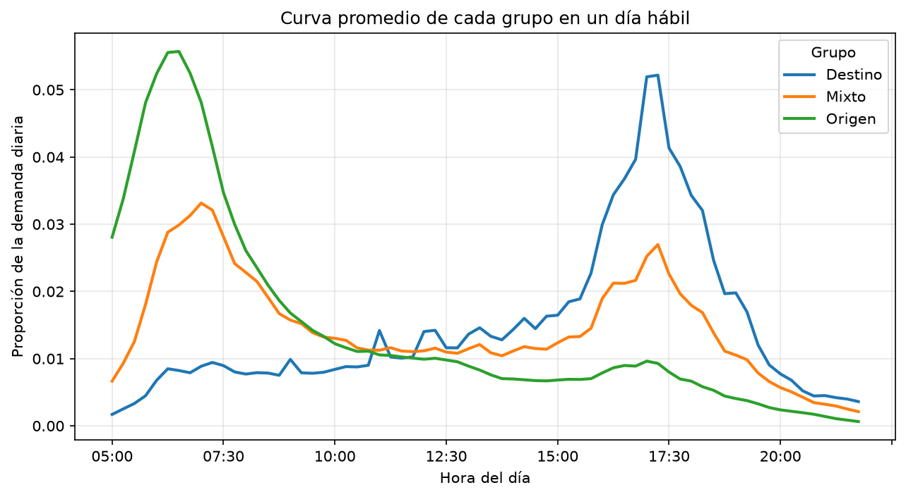

# Aprendizaje no supervisado: estaciones de TransMilenio

Agrupamos las 121 estaciones troncales de TransMilenio según la forma de su curva de demanda en un día hábil, es decir, qué parte de sus validaciones ocurre en cada franja de 15 minutos, sin importar cuántos pasajeros mueve cada estación. Usamos K-means y agrupamiento jerárquico de Ward, siguiendo el capítulo 16 de Palma Méndez (2008), *Técnicas de agrupamiento*.

## Resultados

| Grupo | Estaciones | Demanda de 05:00 a 09:00 | Demanda de 16:00 a 20:00 | Franja pico |
|---|---|---|---|---|
| Origen | 41 | 61 % | 10 % | 06:30 |
| Mixto | 35 | 36 % | 27 % | 07:00 |
| Destino | 45 | 11 % | 49 % | 17:15 |

Las validaciones son entradas al sistema. En las estaciones Origen la gente entra sobre todo en la mañana, para ir al trabajo o al estudio; en las Destino entra en la tarde, para regresar. Las Mixtas tienen un pico en cada franja. K-means numera los grupos de forma arbitraria, así que `analisis.py` les pone el nombre según estas proporciones.



Elegimos k = 3 comparando k de 2 a 7 (`docs/figuras/codo_silueta.png`). Con k = 2 la silueta es mayor (0,54 contra 0,45), pero las 35 estaciones mixtas se reparten entre Origen y Destino. Con k = 4 los tres grupos se mantienen y solo se separa Portal Tunal Cable, que tiene datos en 14 de las 68 franjas. El agrupamiento de Ward con k = 3 forma casi los mismos grupos que K-means: el índice de Rand ajustado es 0,909 (`docs/figuras/dendrograma.png`).

## Requisitos

- Python 3.12 o superior
- Las dependencias de `requirements.txt`: pandas, scikit-learn, scipy, matplotlib y pytest

## Instalación

Windows:

```
py -m venv .venv
.venv\Scripts\activate
pip install -r requirements.txt
```

Linux / macOS:

```
python3 -m venv .venv
source .venv/bin/activate
pip install -r requirements.txt
```

## Ejecución

Desde la carpeta del proyecto y en este orden, porque cada script lee lo que guarda el anterior:

```
python src/perfiles.py       # Fase 1: data/processed/perfiles.csv
python src/agrupamiento.py   # Fase 2: data/processed/grupos.csv
python src/analisis.py       # Fase 3: nombres de los grupos y figuras en docs/figuras/
python src/main.py           # Fase 4: programa de consulta
```

Los archivos de `data/processed/` y `docs/figuras/` ya están en el repositorio, así que se puede ir directo a `main.py` o a las pruebas.

## Pruebas

```
pytest
```

Las 6 pruebas de `tests/test_agrupamiento.py` comprueban que los perfiles tienen 121 filas por 68 columnas y que cada fila suma 1, que los festivos y fines de semana no influyen, que K-means da el mismo resultado dos veces, que cada estación está en un solo grupo de 3, que K-means y Ward coinciden (índice de Rand ajustado mayor que 0,8) y que Origen tiene más demanda en la mañana que en la tarde y Destino al revés.

## Datos

- `data/raw/`: Excel *Resumen de Validaciones Troncales al 31 de agosto de 2026, intervalo de 15 minutos*, publicado por TransMilenio S.A. en su [portal de datos abiertos](https://datosabiertos-transmilenio.hub.arcgis.com/).
- `data/dataset_demanda.csv`: lo generamos en la actividad 3 a partir de ese Excel. Tiene una fila por estación, fecha e intervalo de 15 minutos, del 1 al 31 de agosto, de 05:00 a 21:45.
- `data/estaciones.csv`: código, nombre, troncal y si la estación es portal o de transbordo.
